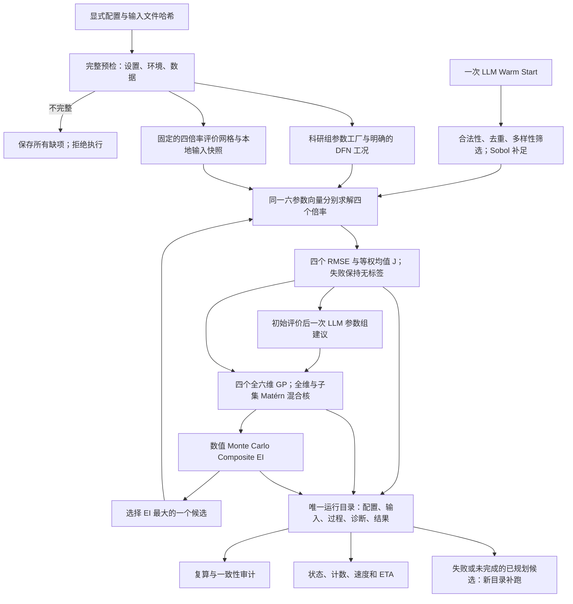

# 整体框架与接口契约

本轮依据用户“先把整体框架搭建起来，并进行审计”的授权实施，科研方法以 Method v0.2 为准。Stage0 提示词的只读限制适用于已经完成的初轮审查；它的后续工程约束仍用于验收。此前找不到 Architecture v0.1，用户已要求直接使用 2 号 Method 文档，因此本文件是当前实现的架构说明，不冒充原先缺失的文档。

## 主流程

当前四组消融使用独立的 WarmStart/GP 分组开关。无 WarmStart 的两组共享 8 个固定种子的随机合法点；有 WarmStart 的两组共享 LLM 提出 20 个、再由第二次 LLM 调用按索引选出的 8 个点。初始计划文件及 SHA-256 随各组保存，严格模式不随机补足 LLM 失败。每组初始化后再进行 25 次 BO 更新。下面流程图中的 Sobol 补足是旧配置兼容路径；新消融采用上述显式初始计划。当前随机小试无完整有效点，是否先做可行性预筛仍待确认，正式实验尚未启动。



默认初始分配为 10 个 LLM 点和 10 个 Sobol 点。LLM 关闭或建议不足时用 Sobol 补足，并记录每个初始点的来源。LLM 请求只发生于 Warm Start 和初始评价后的参数组建议；优化循环不调用 LLM。全部仿真顺序执行，每个候选对应四次倍率求解，失败也占候选预算，重试求解次数另记。

四个 GP 都保留完整六维输入；两个 Matérn-5/2 分支共享该倍率的一组 ARD 长度尺度。核混合权重通过有界坐标搜索学习，允许精确取 0 和 0.8。此搜索是有限迭代的数值拟合，不保证找到边际似然的全局最优。每倍率的对数 RMSE 标准化从初始完整有效记录计算一次并冻结。四个条件预测按独立近似组合，反变换后计算 `mean(max(J_best - J_sample, 0))`；J 始终为四倍率 RMSE 的等权均值。

## 模块契约

| 模块 | 接口与职责 |
|---|---|
| `config.py` | `configuration_errors(config)` 一次收集缺项、错误类型、未知键、未支持的设备/并发设置；`parameter_space_from_config` 复用六参数域定义 |
| `data.py` | `WorkbookSchema` 显式映射；`load_four_rate_workbook` 返回四组数据与 SHA-256；`inspect_workbook` 只读盘点 |
| `parameters.py` | 边界、正值/体积分数、固定孔隙率约束；线性/对数归一化与反变换 |
| `pybamm_adapter.py` | `PyBaMMSimulator` 从科研组工厂获取参数并复制；传入逐倍率 SOC、初始/环境温度、截止电压、显式网格和求解器；校验版本与六参数键 |
| `evaluation.py` | `simulate(parameters, series) -> (time_s, voltage_v)`；四倍率固定网格对齐，不外推；保存原仿真、对齐电压、标量残差摘要和逐次求解诊断 |
| `llm.py` / `prompts/` | 可注入 post(payload)→JSON；自定义结构化服务与聊天接口两种传输；生成、索引筛选、参数组共三个提示词；严格解析；请求、响应与 HTTP 诊断归档；只允许有限标量残差摘要 |
| `sobol.py` | 六维确定性 Sobol；保存序列位置；初始化不丢弃多生成的尾部点 |
| `surrogate.py` | 四个可恢复的 GP 状态；幅度、ARD、噪声和混合权重拟合 |
| `acquisition.py` | 仅在廉价候选池计算 Composite EI；不增加电池求解 |
| `optimizer.py` | 单次运行的初始化、固定参数组、GP 更新、候选选择、预算与最优结果 |
| `workflow.py` | 预检、主实验、一个候选的四倍率 smoke、状态查询；统一生命周期与自动结果审计 |
| `recovery.py` | 复用固定候选评价路径，在新目录补跑已知失败/未完成候选；关联原运行 ID |
| `runstore.py` | 唯一 ID、不可覆盖 JSON、追加事件、源码/环境/输入证据、结束状态 |
| `audit.py` | 从归档独立复算对齐、RMSE、J、最优候选、模型标准化和 EI；不改写原运行 |

## 配置如何进入实际执行

配置文件相对数据路径以配置文件所在目录解析，输出路径解析为绝对路径。最新用户更正为 21700，并提供六参数范围、指定 Reference 的 DFN/Chen2020 设计。原 18650 不完整模板作为历史配置保留；当前参数映射、孔隙率问题与已安装环境见 [21700 对齐报告](audits/21700-reference-alignment-2026-10-11.md)。待确认事项解决前不激活真实运行配置。

每倍率的初始条件放在 `conditions_by_rate`，代替旧模板中未接入仿真的全局 SOC/温度/截止字段。`model.parameter_values_factory` 使用 `module:callable`，返回版本匹配的 `ParameterValues`。预检只检查配置与安装元数据，不导入或执行科研组工厂；正式执行前归档固定参数值及其函数源文件。非可序列化参数会明确失败，避免保存不完整的参数化证据。

`initial_state_mode=explicit_soc` 按各倍率 initial_soc 设置初态；`parameterization` 要求 initial_soc=null，求解时不传 initial_soc，以保留 Reference 的参数集初始浓度。参数工厂 `llmbo_para.reference_cell:chen2020_reference_parameters` 只创建新的 Chen2020 对象，不执行 Notebook。

当前内置 DFN 桥接支持显式的恒温模型配置、CasadiSolver safe 模式、五个空间网格点数和正号放电输入。原始电流保留在本地输入快照，进入 PyBaMM 时按已确认的 `discharge_current_sign` 转换。实测温度列可以归档，但不会自动变为恒温仿真的温度条件。其他热模型需要单独实现、验证后再启用。

`legacy_assumed_1s` 必须显式开启并给出 1 s 间隔、额定容量和放电电流符号。只能替代整个缺失的电流列；部分缺失的实测电流不能悄悄替换为额定电流。数据时间必须从零开始，不隐式平移；真实终止条件不足以覆盖评价网格时记录失败，不外推或截短观测来掩盖误差。

## 归档与恢复

每次运行的目录为 `UTC时间_配置哈希前缀_随机ID`，不复用旧目录。

```text
manifest.json                 配置、命令、机器、工作目录、解释器和依赖版本
source/ + source-sha256.json   本次实际源码与配置模板快照
preflight.json                所有预检结果及明确假设
inputs/raw.xlsx               正式运行的原始文件副本及输入哈希
input-series*.json            固定的本地评价网格、电流、电压与来源标记
parameterization*.json        固定电芯参数及函数源文件证据
initial-set.json              初始候选、来源、Sobol 位置
llm/                          提示词、请求、响应、接受的建议或安全错误类型
http/                         实际线上请求体、完整响应、usage/model 标签与脱敏 HTTP 诊断
plans/                        求解前已保存的候选计划
attempts/                     四倍率状态、原始/对齐仿真、RMSE、逐次异常与耗时
models/                       冻结的输出变换、训练数据和 GP 超参数
acquisition/                  候选池、EI、抽样种子、选中索引和当时最优 J
events.jsonl                  开始/完成事件、四倍率求解、进度与速度/ETA
summary.json                  实际最优结果与完成/失败计数
result-audit.json              结束前的结果一致性复核
terminal.json                 completed / completed_with_failures / failed 等结束状态
```

`completed_with_failures` 表示预算已访问完但仍有失败候选，不能解释为全部仿真成功。物理失效、覆盖不足等错误不盲目重试；仅显式 `TransientSimulationError` 按配置重试。补跑使用原本地输入快照，新建运行目录并保存原候选 ID，只允许修改求解器设置或重试次数。未知的未来 BO 候选没有被规划，补跑命令不会伪装为完整断点续训；该剩余预算会单独标记。

配置不允许内联密钥，认证只读取命名的环境变量。`Reference/`、`.env`、`data/raw/`、`runs/` 不进入 Git 提交。CodeGraph 初始化仍按用户此前决定保持关闭。

2026-10-11 增加 openai_chat_completions 桥接：不改动两个任务的科学提示词，把 instructions 放入 system，其余结构化内容放入 user；显式模型、输出 token 上限与 JSON 模式来自配置。只接收正常结束的 JSON 对象，截断、拒绝或解析失败均保留诊断，不把无效内容当作候选。HTTP 不自动重试、不跟随重定向，也不关闭 TLS 校验。客户端声明自身应用标识，和已通过的连通性探测保持一致。

## 验收边界

2026-10-11 更新：真实 DFN 已通过独立四倍率校准案例。IDAKLU 使用显式单线程、容差和步长上限，以 t_interp 输出到实测时间点；事件提前终止仍判为覆盖失败。保留 Casadi safe 分支供历史配置复现。model.fixed_electrolyte_diffusivity_multiplier 默认 1，仅作用于原 Chen2020 电解液扩散函数；参数化快照同时保存原函数源码哈希、缩放实现及系数。该系数在独立校准阶段选定并冻结，不进入六维 BO。当前实测 pilot 配置为 1.5，属于同数据校准假设。

真实 LLMBO 尚未闭环完成。网络沙箱阻断首个请求；联网重跑又被自动审批拒绝，等待实测派生摘要外发的明确授权。原始 XLSX 和逐点电压曲线不在请求体中。最新记录见 [校准审计](audits/21700-electrolyte-calibration-2026-10-11.md)；以下早期验收描述保留作历史。

本轮验证软件框架、回归问题、结果复算与故障补跑。2026-10-11 已通过替代 API 的真实 LLM 调用与五候选合成闭环，见 [运行报告](audits/newapi-live-2026-10-11.md)；尚未验证真实科研任务中的提示词效果。真实 PyBaMM/科研组参数化、GPU 加速、其他热模型尚未验收。Method 3.6 的单 GP 基线、固定/随机参数组消融、独立重复实验和三倍率训练/3C 留出实验列入后续阶段，当前入口不会把 3C 当成未见工况。主方法始终使用全部四倍率训练。

PyBaMM 条件传递接口参考官方 [Simulation 文档](https://docs.pybamm.org/en/v26.3.1/source/api/simulation.html) 与 [参数设置示例](https://docs.pybamm.org/en/v26.3.1/source/examples/notebooks/change-settings.html)。当前对接验证使用假的 PyBaMM 模块检查参数传递，不能替代真实电池求解 smoke。

## Approved feasibility initialization (2026-10-11)

The approved policy is docs/proposals/feasible-initialization-2026-10-11.md. FeasibleInitializer calls the existing ParameterSpace and FourRateEvaluator, first applying the necessary inventory bound derived from fixed geometry/initial concentrations and recorded discharge charge. It continues seeded uniform random draws or separate LLM generation/selection/refill until eight complete labels or the finite budget is reached. A two-point audit precedes scale-up. LLM recovery sees only allowed parameter/duration summaries, never pointwise voltage data.

The workflow verifies cached source records, simulation/data signature, relevant implementation hashes and fixed parameterization before GP training. Archived source records and fingerprints make downstream audits independent of the original cache directory. The optimizer counts cache hits separately, filters BO pools by the same necessary condition, and records failed BO evaluations without inventing labels. Frozen transforms and all GP/acquisition states remain auditable.

Random continuation validates the prior plan, regenerates and skips the consumed seeded draws, retains accepted evaluations and cumulative cost, and saves only new solver attempts in a new directory. The suite preserves independent family outcomes, full screening cost including failed families, standalone-attributed cost curves and unique shared preparation cost. No scientific range, voltage cutoff or measured-grid coverage rule is changed by this implementation.
