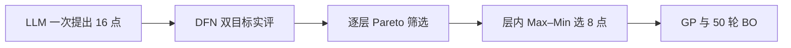

# WarmStart 五种子电热合成试验诊断（2026-10-27）

## 证据边界

本诊断只读取已封存的 0.5C/1C、各 60 s、五种子三臂试验；不新增 API 或 DFN 求解，不修改旧实验。源码提交为 `c87a866`，原始归档位于 `D:\Users\aa133\Desktop\LLMBO_Para\bo-repair-work\20261017_et_implementation\three-arm-50round-eof-20261027`，最终 15 个 case 和 750 轮的独立分析见其 `analysis/analysis.json`。HV 固定使用 `[F_U/0.1 V,F_T/1 K]` 与参考点 `[10,10]`。

本轮观察不能证明“WarmStart 无效”：WarmStart 初始八点在五个种子的 HV 全部高于普通 BO 八点。问题是这项初始优势没有稳定转化为 50 轮后的净收益，尤其在相同 DFN 求解成本下。

## 可复算观察

参数距离在配置的六维线性或对数归一化坐标中计算，`d(x,z)=sqrt(sum_j(x_j-z_j)^2/6)`。表中“平均距离”为八点的 28 个两两距离均值。初始与最终 HV 均在固定指标空间比较。

| 种子 | 初始 HV：BO / WarmStart | 50 轮 HV：BO / WarmStart | 八点平均距离：BO / WarmStart | LLM 池第 0 Pareto 层大小 |
|---:|---:|---:|---:|---:|
| 376330 | 99.32972 / 99.66740 | 99.82976 / 99.79749 | 0.427 / 0.291 | 4 |
| 633262 | 98.84781 / 99.58464 | 99.87335 / 99.89274 | 0.430 / 0.261 | 4 |
| 789058 | 98.97521 / 99.68548 | 99.86169 / 99.78680 | 0.412 / 0.228 | 7 |
| 609653 | 99.24417 / 99.61363 | 99.80812 / 99.74746 | 0.409 / 0.210 | 5 |
| 362724 | 98.84369 / 99.28387 | 99.77745 / 99.86317 | 0.427 / 0.199 | 4 |
| **均值** | **99.04812 / 99.56700** | **99.83007 / 99.81753** | **约 0.421 / 0.238** | — |

每种子 WarmStart 均以一次成功 API 请求得到 16 个完整实评候选；五份首次请求的 `history` 长度均为 0，因此这次实际行为是**无真实误差反馈的一次性批量提案**。不存在候选不足、无效温度补零或反复请求导致的本轮质量下降。其选中八点的 HV 与完整十六点池的 HV 相等，说明现行规则在本样本中没有丢失已有 Pareto 前沿的 HV。温度与电压对初始标量质量的主导次数总体接近，也没有观察到仅按电压误差排序的实现错误。

`electrothermal_llm.py::warmstart_selection_details` 当前按 Pareto 层顺序取点；每层第一个点按固定双目标标量质量 `q` 选取，其后才按归一化参数 Max–Min 距离选取，较高层的远点不能越过较低层的近点。`warm_start_candidates_electrothermal.txt` 要求“plausible balanced candidates with alternatives”，但没有可检验的跨参数空间覆盖配额。候选池十六点自身的平均两两距离为 0.274–0.349，已低于普通 BO 初始化八点的 0.409–0.430；层级筛选进一步使最终距离降至 0.199–0.291。

固定尺度下，普通 BO 从初始到 50 轮平均 HV 增加 0.78195；WarmStart-only 增加 0.25053。增加量较小也可能部分源于其更高的起点，不能单独解释为优化器故障。等 50 轮的五种子 WarmStart-only−BO 平均 HV 差为 −0.01254，配对 95% t 区间跨 0；WarmStart 另多用每种子 16 次 DFN 候选筛选。因而目前证据支持“初始质量好但覆盖度窄、没有证明净收益”，不支持“已查明唯一根因”。

## 只读反事实检查

在同一批已评价的 16 点上尝试一个**未进入产品代码**的选择规则：先保留全部第 0 Pareto 层点，再从全池剩余点按到已选集合的最小归一化距离贪心选满八点，质量和 ID 仅用于同分。五个种子的初始 HV 均保持与现行八点完全相同；平均两两距离分别从 0.291→0.412、0.261→0.291、0.228→0.292、0.210→0.371、0.199→0.314。换入点可能具有更大的目标误差，因此这仅说明**同等实评成本下存在改善参数覆盖的选择空间**，不是后续 BO 增益的证据，也不是确认性试验。

## 解释与后续验证原则

1. **高置信观察**：本次 WarmStart 生成完整有效的候选，初始 HV 较好；候选池和选中八点在参数空间明显更集中。
2. **待检验机制**：集中初始化可能减少 GP 对较远区域的辨别能力；当前存档只能证明几何覆盖差异，不能证明它造成最终 HV 差异。候选池生成与选择两环节都贡献了集中性。
3. **比较约束**：任何新规则须使用新的显式规则版本和初始化兼容签名；旧 `pareto_maximin_v1` 归档与审计继续按旧规则复算。先用软件测试验证确定性、Pareto/HV、成本与篡改检测，再在独立预算下做同池、同种子、等 DFN 成本的配对真实合成 BO。不能在现有已封存数据上调规则后把回看收益当成独立验证。
4. **范围**：首个变更只隔离候选选择，保留 Prompt、候选池大小、GP/EI、Region、物理模型和目标尺度。Prompt 扩散候选与 LLM/数值混合池若要研究，须分别作为后续消融，避免同时改动后无法归因。
