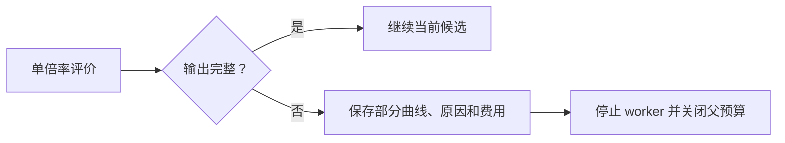

# WarmStart 三臂试验失败即停与缓存审计修复（2026-10-29）

## 问题与修复

独立零调用复现发现，本试验规定的失败即停与原通用评价器的继续行为不同：首倍率求解异常后，通用评价器仍会计算其余倍率；多目标优化器会保存不完整评价并继续下一轮；三臂监督器只检查臂是否完成 50 轮，并未拒绝含失败求解的完成结果。另有合法缓存命中在归档中重复保存同一评价 ID，而新分析器原先一律拒绝重复 ID。

本分支增加**显式试验策略**：`ElectrothermalEvaluator(stop_on_failure=True)` 在首个失败或无效输出后，不再尝试后续倍率或瞬时错误重试；未尝试倍率保留带原因的无效输出。试验 worker 将不完整评价和成本先保存，再停止当前阶段，父监督器关闭预算并保留部分结果。监督器同时拒绝返回了失败求解或不完整目标的完成臂。执行策略写入 `source-execution-pin.json`，父监督器和分析器均校验该字段。默认 `stop_on_failure=False` 保留旧通用评价语义。

严格试验对格式不合法的 WarmStart 回复先记录筛选拒绝，再停止当前阶段，避免自动请求重试；旧控制器默认行为保持。对缓存命中，分析器按初始和轮次顺序核对评价 ID、缓存标志、来源及完整记录一致性，只把真实物理点计入 Pareto 一次；无缓存证据、内容冲突或未见 ID 仍会被拒绝，不同参数即使目标相同也保留为不同样本。

## 验证边界

- 失败策略与缓存边界的初始 RED：7 项失败、1 项通过，退出码 1，原因分别是接口缺失、监督器继续和缓存复评被拒绝；证据在 `bo-repair-work/20261017_et_implementation/warmstart-v3-independent-review-20261029/isolated-red.*`。
- 隔离分支上已进行带网络和电池求解守卫的针对性软件测试，以及一个种子的三臂 50 轮软件 mock。精确计数与最终测试结果以同目录 JUnit 和本分支后续提交记录为准；真实 API 和 DFN 调用为 0。
- 本分支从 `46a593a` 分离，尚需与正在工作的 `codex/warmstart-quality-gate-20261029` 分支集成后重新执行五种子 mock、全量回归、源码封存和独立真实试验。旧运行档案不需要改写。

最终定向回归记录（均为退出码 0，0 次网络请求、0 次电池求解）：

| 验证 | 通过/总数 | 证据目录 |
|---|---:|---|
| 失败策略、缓存审计、旧评价器和 worker | 36/36 | `release-core/` |
| 单种子三臂各 50 轮 mock | 1/1 | `release-one-seed/` |
| 共享候选池及配对选择兼容 | 7/7 | `release-compat-pool/` |
| 试验监督器定向检查 | 13/13 | `release-trial-fast/` |
| 旧初始化兼容 | 29/29 | `compat-init/` |

上述目录位于 `bo-repair-work/20261017_et_implementation/warmstart-v3-independent-review-20261029/`；各自包含 JUnit 与边界计数。本隔离分支尚未执行全量回归，集成后仍须重跑完整回归及五种子 mock，不能将这些结果作为真实 DFN 或实验增益的证据。
