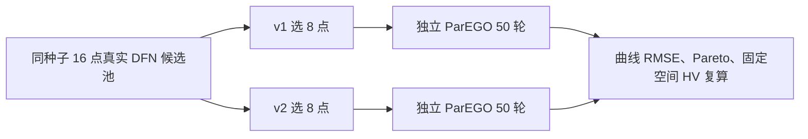

# WarmStart v1/v2 配对合成试验审计（2026-10-28）

## 结论

五个预注册种子的真实 DFN–集总热合成对照已完成。v2 相对 v1 的最终 HV 差值均值为 **+0.02395**，中位数为 **−0.01235**，只有 **2/5** 个种子为正；描述性配对 t 区间为 **[−0.04962, +0.09752]**。这组数据没有证明 v2 在最终 HV 上稳定优于 v1。保留 `pareto_maximin_v1` 为默认规则，不根据本次试验结果调节 v2 后重用这五个种子。

v2 的 0–50 轮 HV 曲线梯形 AUC 差值在 **5/5** 个种子为正，均值 **+0.06710**。这提示 v2 在当前合成任务中可能更快获得早期覆盖，但三组的最终 HV 反而较低。AUC 是次要指标；这一观察不改变上述默认规则决定。

## 冻结方法

使用 [已批准计划](../superpowers/plans/2026-10-27-warmstart-selection-paired-validation-plan.md)和[选择规则设计](../superpowers/specs/2026-10-27-warmstart-coverage-selection-design.md)。每个种子只生成一个包含 16 个完整真实目标对的候选池；v1/v2 各从同池选 8 点，分别运行 50 轮普通 ParEGO。两臂使用相同的 DFN–集总热合成观测、参数范围、随机种子、权重计划、GP/EI 和评价定义。处理差异仅是 `warmstart.selection_rule`；正式 BO 不调用 Region。

拟合倍率为 **0.5C、1C**，各 60 秒；旧 3C 与实测数据均未使用。目标尺度为 `[0.1 V, 1 K]`，HV 参考点为 `[10,10]`。每个倍率的电压和电芯温度来自同一次耦合求解；表中的电压、温度 RMSE 是固定对称规则选出的代表性 Pareto 点，不代替完整 Pareto 参数集。五种子运行顺序为 `152325, 235695, 947445, 260437, 299924`，两臂先后次序交替。

## 实际结果

| 种子 | v1 HV | v2 HV | v2 − v1 HV | v2 − v1 HV AUC | 两组八点重合数 |
| ---: | ---: | ---: | ---: | ---: | ---: |
| 152325 | 99.825567 | 99.885756 | +0.060189 | +0.028160 | 5 |
| 235695 | 99.908170 | 99.889741 | −0.018429 | +0.066833 | 4 |
| 947445 | 99.807301 | 99.786451 | −0.020849 | +0.002051 | 4 |
| 260437 | 99.800918 | 99.788565 | −0.012353 | +0.151842 | 5 |
| 299924 | 99.714640 | 99.825816 | +0.111176 | +0.086604 | 4 |

| 种子 | v1 电压 RMSE (mV) | v2 电压 RMSE (mV) | v1 温度 RMSE (K) | v2 温度 RMSE (K) |
| ---: | ---: | ---: | ---: | ---: |
| 152325 | 1.601 | 1.407 | 0.01790 | 0.01542 |
| 235695 | 2.077 | 1.396 | 0.01277 | 0.01420 |
| 947445 | 0.939 | 1.155 | 0.01918 | 0.02993 |
| 260437 | 1.086 | 2.844 | 0.03518 | 0.02986 |
| 299924 | 3.023 | 1.943 | 0.03320 | 0.00301 |

最终 HV 差值的样本标准差为 **0.05925**。五个种子是五个配对实验单位；500 个 BO 轮次不是 500 个独立重复。平均正差值受最后一个种子的 +0.11118 影响较大，因此同时报告中位数、符号数及完整逐种子结果。

### 归档后独立复核：初始覆盖与完整 Pareto 集

将每个初始点的六个参数按配置中的线性或 `log10` 变换归一化到 `[0,1]`，计算八点之间 28 对欧氏距离的均值，并除以 `√6`。这是参数空间的分散度；数值越大表示初始点越分散，不代表最终拟合更好。

| 种子 | v1 初始平均距离 | v2 初始平均距离 | v2 − v1 |
| ---: | ---: | ---: | ---: |
| 152325 | 0.263805 | 0.355799 | +0.091995 |
| 235695 | 0.153239 | 0.236613 | +0.083373 |
| 947445 | 0.191106 | 0.330862 | +0.139755 |
| 260437 | 0.239715 | 0.285276 | +0.045561 |
| 299924 | 0.244484 | 0.324044 | +0.079559 |

v2 在 **5/5** 个种子中提高了这一初始分散度，而最终 HV 仅 **2/5** 为正。离线次级重放从每臂 8 个初始记录和 50 个正式评价的原始电压、温度曲线复算双目标，并独立重建完整 Pareto 参数行及固定对称规则代表点；十个实验臂均与运行摘要及 `analysis.json` 一致。发布清单中的 **76/76** 个源码文件与源码快照哈希一致；篡改源码哈希或报告的 Pareto 目标值会使次级审计失败。次级复核 **5/5** 项测试通过、退出码 0，真实 API 和 DFN 调用均为 0。复核输出为证据目录下的 `secondary-replay.json`，原归档文件保持不变。

运行器在失败种子的父级摘要中尚未保留完整的部分结果；本次五个种子均成功完成，这一潜在失败路径问题不影响本次配对统计，后续复用运行器前应补齐。

## 成本和验证层级

| 核验 | 实际结果 |
| --- | --- |
| 锁定解释器软件全量回归 | **1694/1694 通过，退出码 0**；网络尝试 0，电池求解尝试 0 |
| 本轮定向测试 | **27/27 通过，退出码 0** |
| 五种子软件 mock 演练 | 10 臂、500 轮；真实 API 0、DFN 0；独立分析完成 |
| 真实 DFN 合成试验 | 10 臂各 50 轮；**1160/1160 DFN**、**5/15 API**；约 5735 秒；进程退出码 0 |
| 归档后重放 | 15/15 阶段闭合、预算哈希链有效；五对曲线分析与保存报告逐项一致 |
| 实测参数辨识 | 未运行；实际电流、T 列测点/单位、初态和冷却条件仍待确认 |

试验使用源码提交 `b79703b`。第一次命令行 mock 演练因 Windows 长路径在源码归档阶段失败；第二次暴露直接运行入口缺少固定源码路径。两次失败均发生于软件演练，真实 API/DFN 用量为 0，失败目录保留。短输出路径和源码路径修复后，独立命令行演练通过。第一次全量回归出现一处未定位的偶发失败并被中止，未形成 JUnit；随后旧 LGBO v2 文件独立运行 **37/37**、与本轮测试顺序相接运行 **64/64** 均通过；最终带 `-x` 的全量执行实际运行了全部 **1694** 项并通过。保留首次日志，不把它记为通过或声称偶发原因已查明。

## 证据与解释边界

- 本轮专用证据目录：`D:/Users/aa133/Desktop/LLMBO_Para/bo-repair-work/20261017_et_implementation/warmstart-v1-v2-paired-20261027/`。其中有协议修订记录、批准记录、源码快照、发布清单、完整 JUnit/日志、预算账本和 `postrun-replay.json`。
- 真实运行归档：`D:/Users/aa133/Desktop/LLMBO_Para/runs/w27/`。`result.json` 保存五个种子的双臂结果，`analysis.json` 保存逐轮 HV、Pareto 参数集、成本轴及配对统计；各臂目录保留原始电压/温度曲线与深度审计。
- 冻结协议 SHA-256：`fc8c9f2994394daba77f9f485f404fb9b9c01ac55ed8317bdbce491a6956a0c9`。归档后重放分别校验了结果、分析和账本文件哈希。
- 本试验验证的是软件闭环及**真实 DFN–热模型生成的合成数据**上的算法比较；没有验证实测拟合、参数唯一可辨识性或跨数据集的 LLM 增益。
