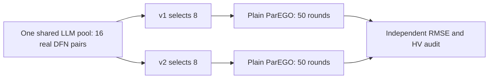

# WarmStart v1/v2 Paired Synthetic Validation Implementation Plan

> **For agentic workers:** REQUIRED SUB-SKILL: Use superpowers:executing-plans to implement this plan task-by-task. Steps use checkbox (`- [ ]`) syntax for tracking.

**Goal:** Measure whether `pareto_core_spacefill_v2` improves the downstream 0.5C/1C electrothermal BO trajectory over the unchanged `pareto_maximin_v1` selector when both start from the same real DFN-evaluated LLM candidate pool.

**Architecture:** A new source-pinned two-arm supervisor acquires and evaluates one WarmStart pool per seed, derives two independently signed eight-point plans from that immutable pool, and runs the existing `MOOptimizer` for 50 new rounds per arm. An independent analyzer recomputes both RMSEs and fixed-space HV from archived curves. Existing three-arm runners, core GP/EI, Prompt, Region and the old voltage task are unchanged.

**Tech Stack:** Python 3.12; locked `D:/Users/aa133/Desktop/LLMBO_Para/.venv-pybamm312/Scripts/python.exe`; PyBaMM 25.10.2; NumPy; pytest/JUnit; single-thread Windows PowerShell.

**Spec:** `docs/superpowers/specs/2026-10-27-warmstart-coverage-selection-design.md`, especially “验收与后续确认”; the user chose five new seeds, a common 16-point pool, v1/v2 eight-point initialization and 50 BO rounds, without Region.

**Read-only readiness at planning:** worktree HEAD `e463d24`, clean before this document; the latest guarded software JUnit has 1667/1667 passes and zero network/battery solves (`bo-repair-work/20261017_et_implementation/warmstart-coverage-20261027/final-regression-verified/`). The dedicated `LLMBO_OPENCODE_API_KEY` exists in the local user/process environment; its value was not printed or archived. A separate two-arm source-pinned runner does not yet exist, so no live comparison is ready to launch.

## Global Constraints and Frozen Comparison Protocol

- This plan is for a **new independent** synthetic trial. The sealed five-seed historical archive is read-only, and its seeds `376330, 633262, 789058, 609653, 362724` are excluded. No previous budget is reopened.
- Generate the five new seeds with `random.Random(20261027).sample(range(100000,1000000),5)`: `[260437,152325,947445,235695,299924]`. Schedule them in the order produced by `random.Random(20261028).shuffle(seeds)`: `[152325,235695,947445,260437,299924]`. Alternate arm order v1/v2, v2/v1, v1/v2, v2/v1, v1/v2. Freeze these bytes before any real request.
- Retain the prior locked **real DFN synthetic** observations, `electrothermal_4e2t`, 0.5C and 1C only, 60 s per rate, 16 complete unique LLM candidate evaluations per seed, eight selected initial points per arm, and 50 **new** BO rounds per arm. Do not use measured XLSX or old 3C. The observations and source hashes must be pinned before release; generating observations incurs zero new solves in this study.
- Retain the existing WarmStart Prompt, candidate-only bound reply, OpenCode `deepseek-v4.1-flash` transport, parameter bounds, solver, objective scales `[0.1 V, 1 K]`, augmented scalarization, GP/EI and fixed HV reference `[10,10]`. Both formal arms use `warmstart_only`, hence zero Region calls. The only treatment difference is the effective `optimization.warmstart.selection_rule`.
- Within each seed, keep the same optimizer random seed, weight schedule and acquisition budget for both arms, but create separate GP, cache and run-store instances. The alternating arm order limits a systematic wall-clock/order bias.
- Use one request/evaluation pool per seed for both arms; at most three candidate-only WarmStart requests per seed may contribute to the 16-point pool under the existing bound/recoverable pre-header EOF policy. No general transport retry. A pool with fewer than 16 complete unique true objective pairs stops that seed and the trial; no random fillers, resampling or fabricated temperature objectives.
- At most **1160 new DFN solves**: `5 × (16 × 2 rates + 2 arms × 50 rounds × 2 rates)`. At most **15 real API requests**: `5 × 3`. One 8-hour absolute wall-clock window starts at live launch; single-thread; each request keeps the existing 120 s bound. No new server task or measured-data BO. Costs are charged before side effects, including failures. An API credential is read from the dedicated local environment only and never written to source, protocol, command arguments, logs or snapshot.
- Treat each seed, not each BO round, as one paired experimental unit. Preserve every seed outcome and failure. No rule tuning, seed substitution or selective rerun after seeing outcomes.

## Outcome and Cost Contract

- **Primary:** paired `HV_v2 − HV_v1` after 50 new rounds, using each arm's optimizer-visible eight initial true objective pairs plus its subsequent complete true pairs. HV uses the fixed `[F_U/0.1,F_T/1]` space and reference `[10,10]`. Both arms are compared after the same number of BO rounds and the same charged screening cost. Also plot HV against **actual cumulative DFN charges**; do not silently assume an uncharged failed or cached call is free.
- **Secondary:** paired difference in the trapezoidal area under each 0–50-round HV trajectory; the initial eight-point HV and six-dimensional mean pairwise normalized distance; and `F_U` and `F_T` of a representative Pareto point selected by the same fixed symmetric quality rule in both arms. Archive full Pareto parameter sets and both RMSEs, so a temperature tradeoff remains visible.
- Report the shared 16-point screening pool's HV separately from optimizer-visible HV. Although the pool's observations exist physically, only the selected eight points enter each arm's GP/Pareto history; the shared screening charge is counted once per seed in experimental resource use and attributed equally in each arm's cost axis. Never count it as two new pool evaluations in the parent ledger.
- Report five paired differences, mean, median, sample SD and sign count. For the primary final-HV difference, also give the descriptive paired t interval `mean ± 2.7764451052 × sample_SD / sqrt(5)`; it is not a universal-gain guarantee. If v2 is not favorable, keep v1 default, preserve negative evidence and do not retune this trial. Historical five seeds are contextual only and are not pooled into the new paired estimate.

## File Map

- Add `scripts/run_et_warmstart_selection_paired.py`: frozen protocol validation, seed/arm schedule, source and input pins, durable parent budget, disabled dry run, owned worker supervision, stop/close behavior.
- Add `scripts/et_warmstart_selection_paired_worker.py`: reuses `et_three_arm_validation_worker` for one candidate pool and both `warmstart_only` formal runs; derives and verifies two signed plans from the common immutable screening records. No optimizer copy.
- Add `scripts/analyze_et_warmstart_selection_paired.py`: independent curve RMSE, Pareto and fixed-reference HV replay; paired and cumulative-cost report; source/pool/plan digest checks.
- Add `tests/test_et_warmstart_selection_paired.py`: protocol, pool-plan provenance, mock closure, failures, cost ledger, mutation and analysis tests. Reuse existing test fixtures where possible.
- Add a short methods/audit note under `docs/audits/` only after actual execution, including positive and negative seeds and exact resource use. Do not rewrite historical study reports.

## Review Focus

1. The two plans have different initialization signatures but identical physical/data/evaluation signatures and byte-identical screening curves; a source-pool mutation, mismatched point or forged rule must fail before formal BO.
2. The generated v1 plan must reproduce the existing v1 selection IDs from the pool run; the v2 plan must pass `load_initial_plan(..., expected_selection_rule='pareto_core_spacefill_v2')`. Cross-import in either direction must fail.
3. Exactly 16 complete unique pool records are required; partial temperature, duplicate physical parameters, too few API candidates, a response binding error or a failed DFN solve cannot become a zero error or a silent filler.
4. Both 50-round arms have zero Region requests and equal common screening attribution; one arm cannot reuse the other's GP state or formal evaluation cache. Every completed run deep-audits independently.
5. Post-result source drift, ledger mutation, cached-cost understatement, changed objective scales/HV reference, changed arm order and replayed seed are detected. A stopped partial trial is labeled partial and excluded from a completed five-pair gain claim.

---

### Task 0: Pin current baseline and proposed study inputs

**Files:** Evidence only under a new `D:/Users/aa133/Desktop/LLMBO_Para/bo-repair-work/20261017_et_implementation/warmstart-v1-v2-paired-20261027` directory; do not create the live `runs/warmstart-v1-v2-20261027` directory in dry run.

- [ ] Record clean Git status/HEAD, the current 1667/1667 JUnit baseline, interpreter and PyBaMM version, frozen synthetic observation/config file hashes, seed derivation, costs and prior archive exclusions. Detect credential **presence only**.
- [ ] Freeze a reviewable proposal containing the five seed configs with budgets disabled, the arm schedule, source file list and hash pins. Verify the proposal contains no credential and states 0 API/DFN until live release.

### Task 1: TDD the two-arm protocol and durable budget

**Files:** New parent script and new test file named in File Map; no changes to the existing three-arm parent.

**Interfaces:** `load_protocol(path: Path) -> dict`; `cases(protocol: dict) -> list[dict]`; `PairedBudget.start(path: Path, *, protocol_sha: str) -> PairedBudget`; `dry_run(path: Path, *, output: Path) -> dict`.

- [ ] Write failing tests for five novel seeds, fixed 10-case arm order, exactly 500 planned BO rounds, limits 1160/15/28800, altered pins/config/rates and duplicate/reordered cases. Run RED and retain JUnit/log/exit.
- [ ] Implement strict protocol, idempotent hash-chain charges and absolute deadline. Charge before API/DFN; refuse duplicate, post-close or over-limit events. Dry run neither reads credential nor creates output. Run GREEN; commit only listed paths.

### Task 2: TDD shared-pool dual signed plans

**Files:** New worker and its tests. Existing `electrothermal_llm.py`, `electrothermal_provenance.py` and `MOOptimizer` should remain unchanged unless a failing contract test proves a narrow required fix; such a fix needs explicit audit in this plan's scope.

**Interfaces:** `derive_paired_plans(pool_run: Path, *, configs: dict[str,dict], out: Path) -> dict[str,dict]` returns paths, file hashes, selected IDs, pool hash and exact shared costs for v1/v2. Use `warmstart_selection_details`, `write_initial_plan`, `load_initial_plan`, `verify_evaluation` and the existing run deep audit. The candidate pool is acquired once via the existing bound WarmStart worker under v1; the source's own v1 selected IDs must equal the derived v1 IDs.

- [ ] RED tests: both plans import under their own rule; cross-import fails; 16 complete unique original records have identical parameters/curves/errors in both plan histories; v1 IDs reproduce source; source mutation, false costs, forged signature/rule, duplicate and partial records are rejected.
- [ ] Implement derivation that rebinds only rule-dependent initialization signatures while retaining physical record content, origin run ID and the shared cost events. Add an external pair manifest hashing the original pool artifacts and both plans; never rewrite the source run. Run GREEN and focused audit tests; commit explicit paths.

### Task 3: TDD formal paired arms and independent metrics

**Files:** New parent/worker/analyzer scripts and tests.

**Interfaces:** `run_arm(...)` delegates to the existing source-pinned `warmstart_only` worker with its corresponding signed plan and `total_candidate_budget=58`; `analyze_pair(archive: Path, protocol: dict) -> dict` recomputes two-rate voltage/temperature RMSE, both full Pareto sets, representative pairs, per-round HV and actual charge axes.

- [ ] RED mock tests for both arms using the same 16-point pool but different selected IDs, zero Region/API in formal rounds, 50 new evaluations each, independent GP histories, equal pool cost attribution and verified v1/v2 plan hashes. Add forced API/DFN/temperature failure and source/scale/cost mutation tests.
- [ ] Implement only the wiring and independent analyzer; use no live API or DFN in tests. GREEN targeted suite and commit explicit paths.

### Task 4: Software release and zero-call rehearsal

**Files:** Proposed protocol, disabled configs, source snapshot and evidence outside old archives; no live output until release.

- [ ] Run the complete locked-interpreter software suite with fresh JUnit/log/exit and offline network/battery-solve guards; reconcile any failure. Verify source/test hashes before and after and clean Git status. Capture an actual process exit; if Windows shutdown stalls after pytest has written its result, distinguish pytest return from outer process status and repair the test harness before claiming a normal exit.
- [ ] Run `--dry-run` and a full mock two-arm closure with source-pinned workers. Check exact 10 cases, 500 rounds, 1160/15 upper-bound arithmetic, credential-free protocol, archived curves/RMSE/HV, deep audit and zero actual API/DFN.
- [ ] Freeze the implementation commit/source snapshot, observations, configs, runner and analyzer hashes, then create a `software-release.json` with passing gates. Report the ready-to-run protocol and exact unchanged independent budget gate.

### Task 5: Execute only under the newly approved independent live budget

- [ ] Before the first side effect, validate the frozen live protocol, this plan's approval, release hashes, dedicated key **presence** and a new parent ledger; start the 8-hour clock once. Stop on a binding failure, incomplete 16-point pool, cap/deadline, source drift, failed independent audit or incomplete formal arm. Do not restart a closed trial automatically.
- [ ] Generate each seed's shared pool once, derive both signed plans, run arms in the frozen alternating order, and archive charges and partial/failure diagnostics. No Region calls or measured data.
- [ ] Independently replay all curve-derived RMSEs, Pareto sets and fixed-space HV; write per-seed and paired results with all adverse outcomes. Report software pass, real DFN synthetic result and measured-data status separately. No parameter-identifiability or general LLM-gain claim from five seeds.

## Handoff and Approval Boundary

Tasks 0–4 are software/protocol work. The earlier WarmStart selector approval gave **0 new API/DFN**; the user has confirmed the paired design but has not yet set a new solve/request/time ceiling. Do not start Task 5 or treat old closed budgets as available until this plan and the independent **1160 DFN / 15 API / 8-hour** cap are explicitly approved. Approval of this plan should authorize Tasks 0–5 within those exact limits; if implementation changes that arithmetic or the scientific treatment, return for review before live execution.
