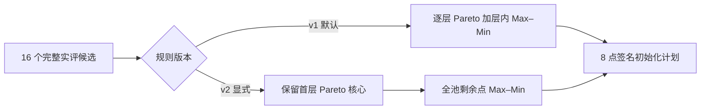

# WarmStart 参数覆盖筛选设计（待审）

## 意图与证据

现有 0.5C/1C、各 60 s 的五种子真实 DFN 合成对照显示：WarmStart 初始八点的 HV 在 5/5 种子中优于普通 BO，但 50 轮后的等成本收益没有得到证明。归档中候选均有效；每种子只有一次、无历史双目标反馈的 LLM 批量请求。WarmStart 八点平均参数距离为 0.199–0.291，普通 BO 为 0.409–0.430。完整诊断见 `docs/audits/warmstart-five-seed-diagnosis-2026-10-27.md`。这些数据支持改善覆盖的研究假设，尚不证明最终 BO 增益。

目标是在现有 16 个已实评候选、8 个初始化点和原有评价成本内，保留初始 Pareto 质量，同时给 GP 提供更广的六维参数覆盖。温度 RMSE、电压 RMSE、目标尺度、GP、EI、Region 和物理模型均不变。

## 考虑的路径

| 路径 | 收益 | 代价与可归因性 |
|---|---|---|
| **A：只改选择，保留候选池**（本设计建议） | 同一真实目标池可离线复算；不增加求解或 API；直接检验覆盖机制 | 仅改善池内选择，不能扩大 LLM 自身的候选分布；真实 BO 收益仍未知 |
| B：先改 Prompt 的候选分布 | 有机会扩大十六点池的覆盖 | LLM 输出与选择同时变化，已有档案无法隔离；需要新 API 和 DFN 预算 |
| C：在池中混入数值空间填充点 | 可显式保证全局覆盖 | 改变 LLM/数值候选配比和初始化含义，需单独设计与实评 |

暂按 A 起草；用户可在批准前改选。B、C 是后续独立消融，不并入 A。

## 精确选择契约

新增显式规则 `pareto_core_spacefill_v2`，仅在新版电热 `electrothermal_4e2t` 配置 `optimization.warmstart.selection_rule` 选择此值时启用。该字段缺失时继续使用现有 `pareto_maximin_v1`；旧配置与运行档案按 v1 复算。

输入为真实完整的 `[F_U,F_T]` 评价记录；按现有验证、物理参数键去重、签名一致性和固定尺度 `[s_U,s_T]` 计算 Pareto 层、对称增广 Tchebycheff 质量 `q` 与六维归一化参数 `x`。无效或部分目标对不进入候选集，也不补零。

1. 设首层非支配集为 `P_0`，初始化名额为 `K`。先从 `P_0` 选点：首点使 `(q,x,评价ID)` 字典序最小；后续点使到已选集合的最小距离最大，同分依次比较 `q,x,评价ID`。若 `|P_0|≤K`，保留全部首层点；若 `|P_0|>K`，按该规则从首层选满 `K`，与 v1 首层分支相同。
2. 若仍有名额，从**全部未选的完整、去重候选**中重复选择最远点。距离为 `min_{z∈S} sqrt(sum_j(x_j-z_j)^2/6)`；同分依次取较小 `q`、较小 Pareto 层号、归一化参数字典序和评价 ID。此时不要求先耗尽次优 Pareto 层。
3. 返回选中 ID、每个候选的层号与质量、归一化参数、去重信息、逐步距离与排序键、规则版本。若少于 `K` 个完整唯一评价，则照旧停止，不能随机补点。

当 `|P_0|≤K` 时，新规则保留完整候选池的非支配集，因此其**初始 HV 必然与完整池一致**；当 `|P_0|>K` 时，八点预算无法保证完整池 HV，必须归档实际 HV，不可声称保留。离线五种子 `|P_0|=4–7`，反事实选点的初始 HV 全部不变，平均参数距离从 `0.291/0.261/0.228/0.210/0.199` 分别增至 `0.412/0.291/0.292/0.371/0.314`；这不是未来 BO 增益证明。

## 兼容、审计与文件边界

- `electrothermal_config.py`：严格允许已知 `selection_rule` 值，缺省 v1；不能以放宽字段校验实现兼容。
- `electrothermal_llm.py`：把选择规则作为纯函数参数；v1 返回字段与排序保持逐字节兼容；新分支仅改变上述填充步骤。控制器从配置传入规则。
- `electrothermal_provenance.py`：初始化兼容签名纳入**生效的**规则。签名构造先从 `warmstart` 子字典移除可选 `selection_rule` 字段，再以独立 `selection` 字段写入生效规则；因此在**同一源码指纹**下，缺省 v1 与显式 v1 的初始化兼容签名相同，v2 则不同。源码变更本身会改变模型及后续签名，不能要求新运行哈希等于旧封存运行哈希；旧运行须用其封存源码通过深度审计。完整配置 SHA 仍反映字段是否显式出现。导入计划时按历史声明的规则重算，并由初始化签名拒绝 v1/v2 混用。
- `electrothermal_audit.py`：按记录及配置中的规则重放；篡改规则、目标、参数、选择顺序、尺度或初始计划应失败。旧封存档案必须继续通过深度审计。
- `docs/Method.md`：把 v1 与 v2 的初始化选择规则、适用协议和成本可比性写清，保留已发表实验原规则表述。
- 不修改旧电压单目标流程、旧缓存、已封存五种子结果和原 LLMBO-MO 参考工程。新规则不得被旧六维语义误用。

## 验收与后续确认

软件层先运行本次基线，TDD：构造首层与次层点，证明 v2 保留首层、提高覆盖，v1 结果不变；测试首层超过名额、任意输入顺序、重复参数、同分、部分目标、不同尺度；验证配置和初始化签名隔离、旧新计划互拒、深度审计篡改检测；最后跑针对性和完整回归。离线五种子反事实只检查选择几何与初始 HV，不能作为增益结论。

真实 DFN 合成确认须另设独立预算。建议在**新、预注册种子**上令 v1/v2 使用相同的 16 候选真实评价池，分别用八点计划做同样的 BO 轮次；主指标为固定空间 HV 对累计 DFN 成本，辅以同一 Pareto 代表点的 `F_U,F_T`。因源码签名变化，旧归档初始计划不得直接导入新运行；需在新协议中重评候选或经单独审阅建立严格等价迁移。实测辨识仍受电流、测温和冷却边界确认阻塞。
