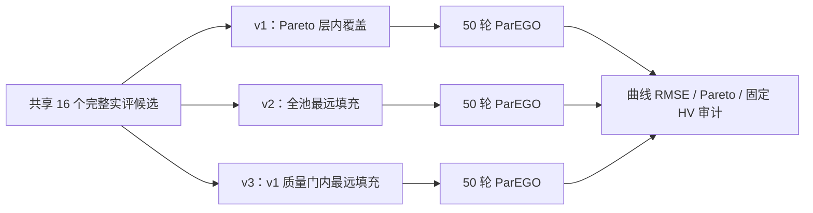

# WarmStart 质量门控覆盖与新种子确认设计

## 目标与边界

目标是检验：在保留 Pareto 首层和一定六维参数覆盖的同时，限制 v2 选入目标误差明显较差的远点，能否提高 50 轮后的固定空间 HV。当前 v1、v2 均按旧版本保留；新规则是显式 opt-in 的 `pareto_quality_gated_spacefill_v3`，不复用旧签名，也不把 v3 改名为 v2。旧五种子只用于发现机制，不作为改版后的确认样本。

物理模型、六参数、0.5C/1C、各 60 秒、两目标、尺度 `[0.1 V,1 K]`、HV 参考点 `[10,10]`、Prompt、ARD Matérn GP、标量化与 EI 保持。正式 BO 仍为 WarmStart-only，Region 关闭；不使用实测数据或旧 3C。

## 方法选择

已检查的 v2 实现与规格一致：首层全保留，剩余名额以距离为主，质量仅作同分规则。五个旧池的初始 HV 相同；v2 的平均参数距离、平均质量分数 `q` 均更高，后一项意味着更差；50 轮最终 HV 只有两组改善。采用质量门控是一个**新研究假设**，不是已证实的缺陷修复，也不承诺每个种子同时改善两个 RMSE。

没有选择给距离与质量设置连续加权系数，因为旧五个结果不足以无偏选择该系数；也没有引入后验感知选择，因为它会改变初始化之外的 GP 机制并扩大本轮归因范围。

## v3 确定性选择契约

输入为同一候选池内的真实完整目标对，经过当前物理参数键去重、配置/数据/模型签名核验；部分或失败结果不进入。目标质量沿用固定对称增广 Tchebycheff：

\[
q_i=\max\left(\frac{F_{U,i}}{2s_U},\frac{F_{T,i}}{2s_T}\right)
    +0.05\left(\frac{F_{U,i}}{2s_U}+\frac{F_{T,i}}{2s_T}\right),
\quad (s_U,s_T)=(0.1\,\mathrm V,1\,\mathrm K).
\]

六维参数按现有线性/`log10` 变换归一化到 `[0,1]^6`；距离为欧氏距离除以 `√6`。设名额 `K=8`：

1. 完整复算现有 `pareto_maximin_v1` 的选择结果与每点 `q`，令 `q_gate=max(q_i: i∈S_v1)`。这是同池固定基准，无需根据旧试验结果拟合超参数。
2. 按现有 v2 的首层顺序保留 `P_0`。若首层超过 `K`，直接返回与 v1/v2 相同的前 `K` 点，并归档首层截断。
3. 否则，在未选且 `q_i≤q_gate` 的所有完整候选中，重复选取对当前集合最远的点。精确同分时依次取较小 `q`、较小 Pareto 层号、归一化参数字典序、评价 ID。候选集合在填充前一次确定，不因一次选点而扩大；距离每步重新计算。
4. 若完整唯一候选少于 `K`，按现有规则失败，不随机补点。由于 v1 的 `K` 个点都满足 `q_i≤q_gate`，候选充足时门内一定能填满。输出 `selection_rule`、版本、`q_gate`、v1 基准 ID、入选 ID、逐步排序键、归一化坐标、目标尺度和全部已有审计字段。

门控只保证每个**入选候选**的 `q` 不超过 v1 八点中的最差值，不保证 v3 的平均 `q`、终局 HV、两个 RMSE 或参数可辨识性。首层大小不超过 `K` 时，三臂的初始 HV 均等于共享池的 HV；超过时归档实际初始 HV。

## 接口、兼容与审计

- 在 `electrothermal_config.py` 中仅增加新规则的严格枚举；缺省继续是 `pareto_maximin_v1`。当前另一工作树未提交的无版本默认规则修改不得进入本设计。
- `warmstart_selection_details(...,rule=...)` 新增独立 v3 分支；v1/v2 输出和排序保持不变。`select_electrothermal_warmstart` 仍为薄接口。
- 初始化计划与缓存签名纳入生效规则；三个版本即使共享六维参数含义，也不能跨规则导入。审计从原始候选重算 `q_gate`、排序、目标及签名；篡改门槛、质量、参数或顺序须失败。
- 原双臂运行器与旧档案只读。新三臂监督器复用现有单臂 BO 数值骨干和源锁定、预算账本，记录失败种子的部分阶段结果。避免复制 GP/优化器或改动旧电压任务。

## 分级验收

1. **软件**：先固定干净分支基线。TDD 覆盖 v1/v2 逐字节行为、v3 门槛及同分、首层超预算、重复/部分目标、变换、签名互拒、审计篡改、失败种子归档；软件 mock 三臂 5 种子各 50 轮，0 API/DFN，完整回归有 JUnit/退出码。
2. **真实 DFN 合成确认**：另一个独立协议使用新种子 `[659578,564327,336546,769762,465948]`，每种子共享 16 个真实候选评价，v1/v2/v3 各选 8 点，各运行 50 轮。三臂执行次序依次为 `v1→v2→v3`、`v2→v3→v1`、`v3→v1→v2`、`v1→v3→v2`、`v2→v1→v3`，避免某一规则总在同一位置运行。总上限 `5×(16+3×50)×2=1660` 次 DFN，最多 `5×3=15` 次 API，单线程、无自动重试、墙钟 8 小时。开始前冻结请求/配置/源码/观测哈希，预算在副作用前扣账，失败即停并保留部分结果；独立审计全部曲线 RMSE、Pareto/HV、成本。此次上限已在上一轮答复中明确展示；用户随后要求“重启实验”，作为新试验授权记录。旧预算不恢复。
3. **结果判读**：主要报告每种子 `HV_v3−HV_v2`，并以 `HV_v3−HV_v1` 作基准；次要报告 0–50 轮 HV AUC、初始距离/质量、同一对称代表点的 `F_U,F_T`。给均值、中位数、符号数、样本标准差与五对描述性区间；不能把 250 轮当 250 个独立样本。只有新种子结果可用于确认。若增益不稳，保留 v1 默认及全部负结果。
4. **实测**：实际电流、测温语义/单位、初态和冷却条件未确认，继续阻止正式实测辨识。

